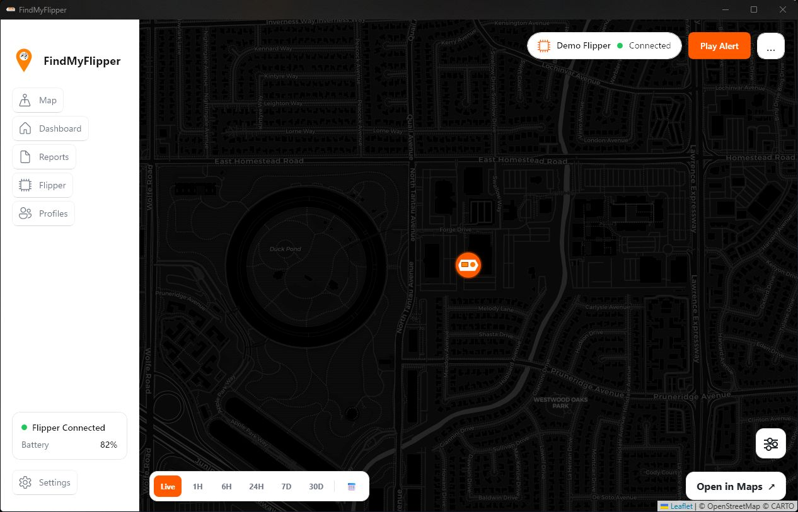
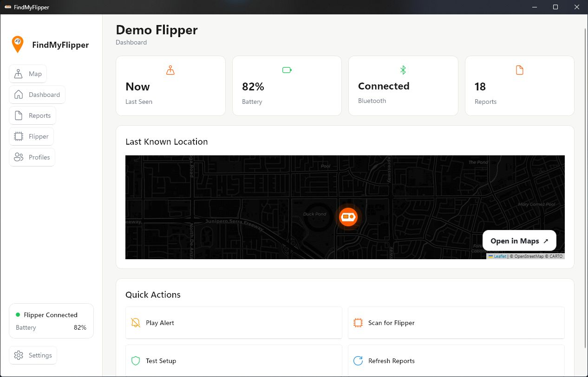
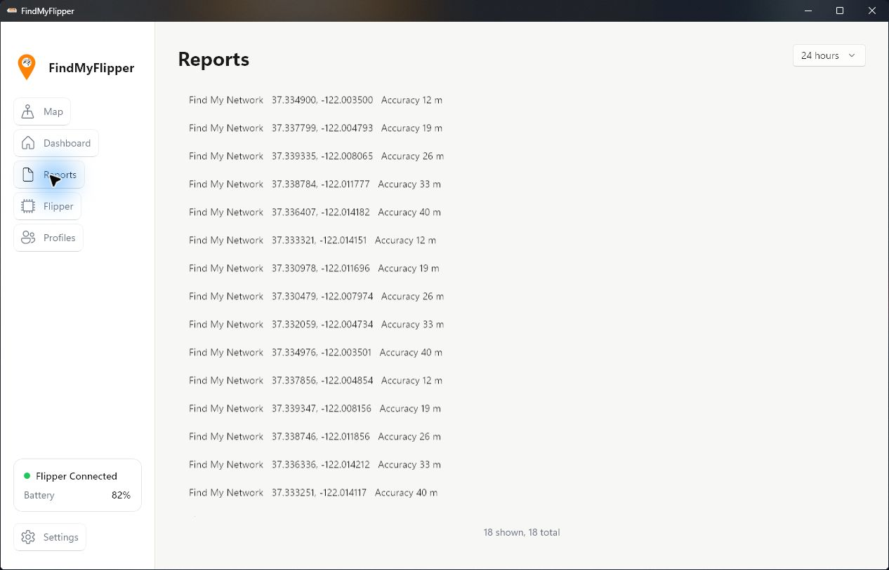
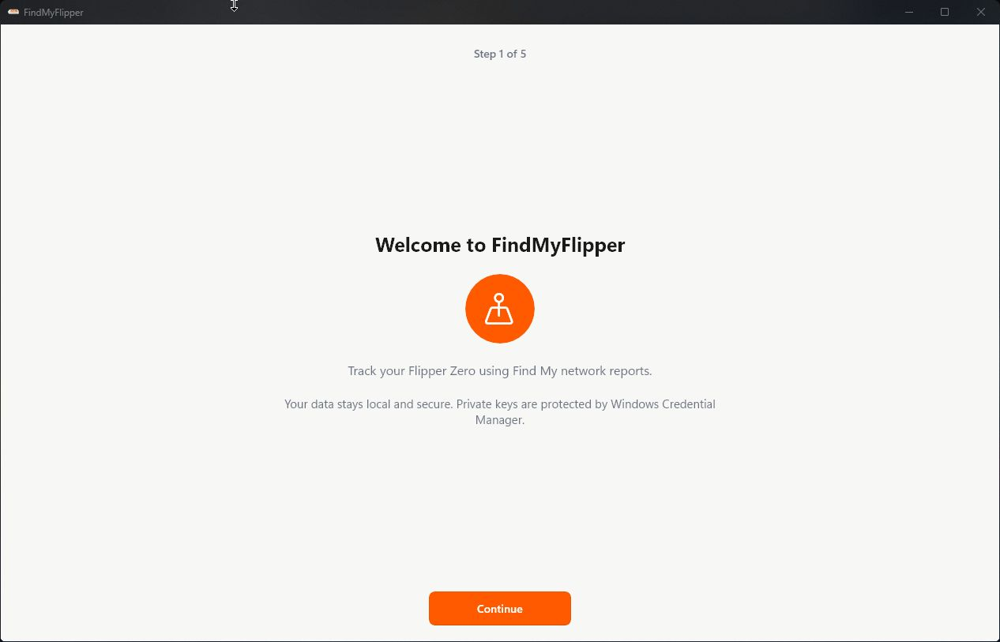
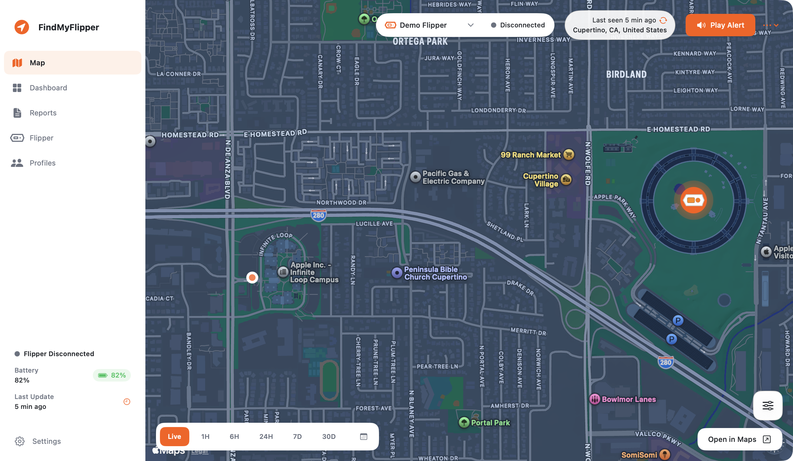
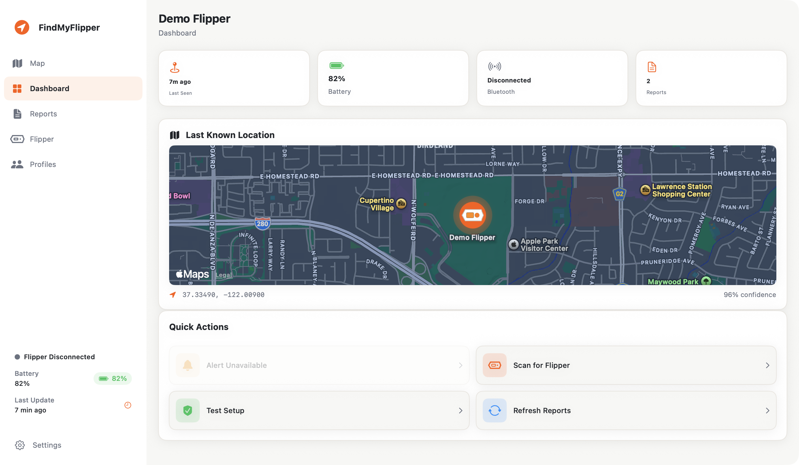

<p align="center"></p>

# FindMyFlipperGUI

FindMyFlipperGUI is a native desktop companion for locating your own Flipper Zero with Find My network reports. The repository contains first-class native apps for Windows and macOS plus the shared local FastAPI backend.

> Use this software only with a Flipper Zero and Find My identity that you own or are authorized to manage.

## Windows app

The Windows app is a native C++20/C++/WinRT and WinUI 3 application. It uses Windows Bluetooth LE APIs, Windows Credential Manager, Win32 notification-area APIs, Windows App SDK, and WebView2 only for its local Leaflet map. Python is bundled into two standalone executables; end users do not need Python, Visual Studio, Node.js, Electron, or Docker.



| Dashboard | Reports |
| --- | --- |
|  |  |



The Windows screenshots were captured from the compiled native application in its isolated demo mode. All displayed names, identifiers, locations, and reports are fictional.

Windows features include:

- Five-step onboarding with `.keys` import, local key generation, USB Flipper import/copy, Apple access, and native BLE selection.
- Private key material and Apple credentials stored in Windows Credential Manager rather than profile JSON.
- Native BLE scanning, stable device ordering, saved-device reconnect, public/random Bluetooth MAC display, RSSI, battery, firmware discovery, and alert playback.
- A confirmation-protected firmware and microSD key-status refresh.
- Live, 1-hour, 6-hour, 24-hour, 7-day, 30-day, and custom map timelines; marker focus; zoom; light, dark, terrain, and satellite layers.
- Dashboard, reports, profiles, Flipper details, diagnostics, themes, tray menu, and loopback-only local services.
- Portable ZIP and Inno Setup installer packaging.

### Windows build

Requirements: Windows 11, Visual Studio 2026 18.7 or newer with C++ WinUI tools, toolset v145, Windows SDK 10.0.26100.0, PowerShell, and Python (packaging only).

```powershell
Set-ExecutionPolicy -Scope Process Bypass -Force
.\packaging\build_windows.ps1 -Platform x64 -Configuration Debug
.\packaging\build_windows.ps1 -Platform x64 -Configuration Release
.\packaging\package_windows.ps1 -Platform x64
```

The current native source revision is `windows-native-build-fix-19`. Windows-specific implementation and QA notes are in [`WINDOWS/FindMyFlipperWindows`](WINDOWS/FindMyFlipperWindows).

## macOS app

The macOS app is native SwiftUI with MapKit, CoreBluetooth, Keychain Services, a menu-bar status item, and the bundled local FastAPI backend.





It supports `.keys` import and generation, Keychain-only private key storage, Apple report access, Bluetooth reconnect and alert, microSD key deployment, profiles, diagnostics, and seven themes.

### macOS build

Requirements: macOS 14 or newer, Xcode command-line tools, Swift 5.9+, and Python 3.11+.

```bash
cd MAC/FindMyFlipperMac
cd Backend
python3 -m venv venv
source venv/bin/activate
pip install -r requirements.txt
cd ..
swift build
./build_and_run.sh
```

## Privacy and security

- Local services bind only to `127.0.0.1`.
- Windows stores secrets in Credential Manager; macOS stores them in Keychain.
- Profile files contain non-secret metadata only.
- Apple passwords and 2FA codes are passed to the local authentication flow and are not persisted by the app.
- Generated Find My MAC addresses and physical Bluetooth identifiers are modeled separately.
- Never commit `.keys`, credentials, tokens, runtime logs, or user data.

## Repository layout

```text
FindMyFlipperGUI/
├── WINDOWS/FindMyFlipperWindows/   # Native Windows C++/WinRT app and backend entries
├── MAC/FindMyFlipperMac/           # Native macOS SwiftUI app and backend
├── packaging/                      # Windows build, validation, ZIP, and installer scripts
├── IMG/                            # Product images and sanitized real-app screenshots
├── RELEASE_NOTES.md
└── README.md
```

The retired Electron Windows implementation is preserved separately in the archived `FindMyFlipperOld` repository.

## Credits

FindMyFlipperGUI is based on and compatible with [FindMyFlipper](https://github.com/MatthewKuKanich/FindMyFlipper) by Matthew KuKanich. The native Windows work follows the product design and behavior established by this repository's native macOS app.

Thanks to the Windows App SDK, C++/WinRT, WinUI, WebView2, Leaflet, OpenStreetMap, CARTO, FastAPI, Uvicorn, PyInstaller, SwiftUI, MapKit, CoreBluetooth, cryptography, and supporting open-source communities. Detailed notices are included with each native app.

## License

MIT © Arxhsz
